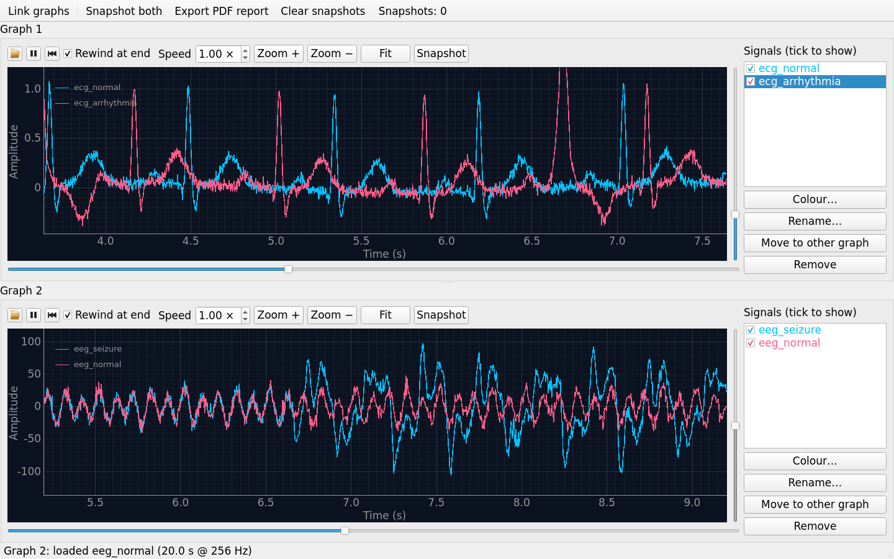
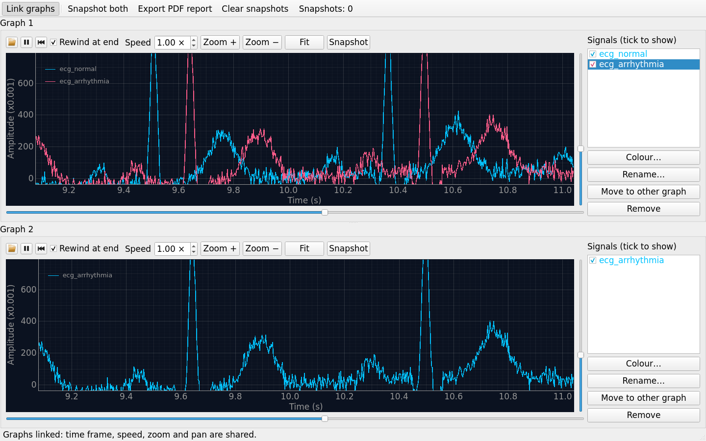

<div align="center">

# 📈 Signal Viewer

**A multi-port, multi-channel biomedical signal viewer for ECG, EMG and EEG: ICU-style cine playback, two linkable graphs and PDF reports built in code.**




</div>

---

## 📖 Overview

Monitoring vital signals is central to every ICU. **Signal Viewer** opens any number of recordings, streams them like a bedside monitor in two graphs that run independently or linked, and documents what you see in a PDF report generated in code.

It implements **Task 1 – Multi-Port, Multi-Channel Signal Viewer** from the Digital Signal Processing course at Cairo University's Faculty of Engineering (Biomedical Data Engineering). This repository is a ground-up rewrite with a modular codebase and automated checks for every requirement.

## 📋 The task statement

> *Using Python and Qt, develop a desktop application that illustrates a multi-port, multi-channel signal viewer.*
> The full statement is in [`docs/task-statement.pdf`](docs/task-statement.pdf).

How each requirement is met:

| Requirement from the statement | How Signal Viewer meets it | Where |
|---|---|---|
| Browse the PC to open any signal file | Folder button on each graph opens a file browser (multi-select, CSV/TXT, header and time column detected automatically) | `graph_panel.open_files`, `signal_model.load_signal` |
| Samples of three medical signals, normal and abnormal | ECG (normal / arrhythmia), EMG (healthy / myopathy), EEG (normal / seizure) are included in `samples/data` | `samples/` |
| Two identical graphs, each with its own controls | Two `GraphPanel` instances, each with transport bar, speed, zoom, sliders and signal list | `main_window.py` |
| Run independently or link with a button; when linked, same time frame, speed and viewport (zoom and pan) | **Link graphs** toggle. Every view change (time, speed, zoom, pan, play state) is mirrored both ways; Graph 1's clock drives Graph 2 frame by frame so they never drift | `set_linked`, `view_state`, `apply_view_state` |
| Signals open in cine mode, never static | Opening a file starts playback immediately | `add_signal` |
| Rewind when the signal ends: stop or start again | **Rewind at end** on: starts again; off: stops at the end. Rewind button returns to the start | `_advance_frame`, `rewind` |
| Change colour | **Colour…** opens the standard colour picker | `change_color` |
| Label / title for each signal | **Rename…**; the label updates the list, the legend and the report | `rename` |
| Show / hide | Tick box per signal | `_on_signal_item_changed` |
| Control / customise cine speed | Speed box from 0.25× to 5× in 0.25 steps | `speed_spinbox` |
| Zoom in / out | **Zoom + / −** (time and amplitude), mouse wheel, **Fit** to reset | `zoom`, `reset_view` |
| Pause / play / rewind (on/off) | Play/pause, rewind and the rewind-at-end toggle | transport bar |
| Scroll through sliders, pan with the mouse, in any direction | Horizontal slider scrolls time, vertical slider scrolls amplitude, drag to pan | `_on_time_slider`, `_on_amplitude_slider`, `_on_mouse_view_change` |
| Move a signal from one graph to the other | **Move to other graph** | `request_move`, `take_signal` |
| Boundary conditions: no scrolling or panning before the start, after the end, above the maximum or below the minimum | View limits and every slider/zoom/pan are clamped to the data of **all** opened signals (shown or hidden) | `_update_bounds`, `_clamp_amplitude_view` |
| Manipulations apply to every opened signal, shown or hidden | View changes act on the whole plot; bounds include hidden signals | `_update_bounds` |
| **The number of signals per graph is not limited** | Signals are kept in an open-ended list; controls act on the selected signal, so 3 or 30 work the same | `GraphPanel.signals` |
| Report: one or more snapshots plus statistics (mean, std, duration, min, max) in a table, generated in code (not a screenshot turned into a PDF) | ReportLab document: summary, a statistics table per graph, and each snapshot with a table of the signals it shows; multi-page with page numbers | `report.py` |
| Sample reports for different numbers of signals and snapshots | 1 signal / 1 snapshot, 3 signals / 2 snapshots, 6 signals / 4 snapshots | [`docs/sample-reports`](docs/sample-reports) |
| Proper variable and function names | Descriptive names throughout (`cine_time`, `amplitude_view`, `time_window`, …); no single-letter names | all modules |
| Imitate familiar software, don't invent | Media-player transport (play, pause, rewind, speed), file-browser open, colour picker, ICU-monitor sweep, wheel zoom and drag pan as in every plotting tool | |



## ✨ Features

- **Two graphs, independent or linked**: shared time frame, cine speed, zoom and pan while linked; separate clocks when unlinked
- **ICU-style cine mode**: signals stream on open, with play/pause, rewind and a rewind-at-end toggle
- **Any number of signals** per graph, each with its own colour, label and visibility
- **Bounded navigation**: zoom, sliders and mouse pan can never scroll into an empty graph
- **Move** signals between graphs or remove them
- **Reports**: snapshots of either graph or both, exported to a multi-page PDF with statistics tables

## 🏗️ Architecture

```
main.py                       # entry point
signal_viewer/
├── signal_model.py           # Signal dataclass, CSV/TXT loader (header + time-axis detection), statistics
├── graph_panel.py            # GraphPanel: plot, cine timer, controls, bounds, signal manager, view state
├── main_window.py            # two panels, leader/follower linking, snapshots, report export
└── report.py                 # PDF report built with ReportLab
samples/
├── generate_samples.py       # regenerates the six sample recordings
└── data/                     # normal and abnormal ECG / EMG / EEG
scripts/make_sample_reports.py  # drives the real app headlessly to build docs/sample-reports
tests/test_requirements.py      # headless checks of the statement's requirements
docs/                           # task statement, screenshots, sample reports
```

**Linking design.** Each panel exposes a small view state: cine time, time window, speed, play state and amplitude view. User actions emit it and the other panel applies it with echo suppression. While linked, Graph 1's clock drives Graph 2 frame by frame, so they never drift apart.

## 🧪 Sample signals

| File | Description |
|---|---|
| `ecg_normal.csv` / `ecg_arrhythmia.csv` | 72 bpm sinus rhythm / premature wide-complex (PVC-like) beats |
| `emg_healthy.csv` / `emg_myopathy.csv` | Normal bursts / low-amplitude, polyphasic potentials |
| `eeg_normal.csv` / `eeg_seizure.csv` | Alpha/theta background / 3 Hz spike-and-wave discharge |

Your own files work too: CSV/TXT with **time, amplitude** columns, or a single amplitude column (assumed 250 Hz).

## 🚀 Getting started

```bash
git clone https://github.com/Mohamedd-Ayyman/signal-viewer.git
cd signal-viewer
pip install -r requirements.txt
python main.py
```

1. Click the **folder icon** on Graph 1 and open `ecg_normal.csv` and `ecg_arrhythmia.csv`.
2. Open `eeg_seizure.csv` in Graph 2, then press **Link graphs**.
3. Take a few **snapshots**, then choose **Export PDF report**.

### Checks

```bash
pip install pytest
QT_QPA_PLATFORM=offscreen python -m pytest tests          # requirement checks, no window needed
QT_QPA_PLATFORM=offscreen python scripts/make_sample_reports.py
```

## 👤 Author

**Mohamed Ayman** · [Portfolio](https://www.mohamed-ayman.tech/projects/signal-viewer) · [GitHub](https://github.com/Mohamedd-Ayyman) · [LinkedIn](https://linkedin.com/in/mohamed-ayman-8787b0269)
